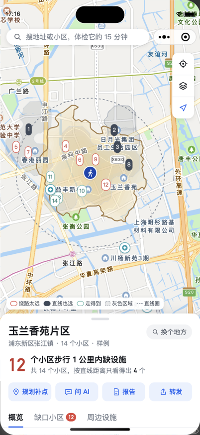
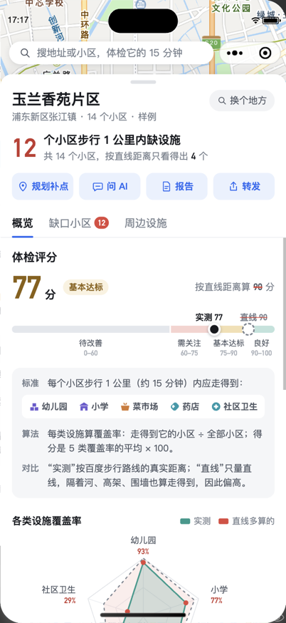
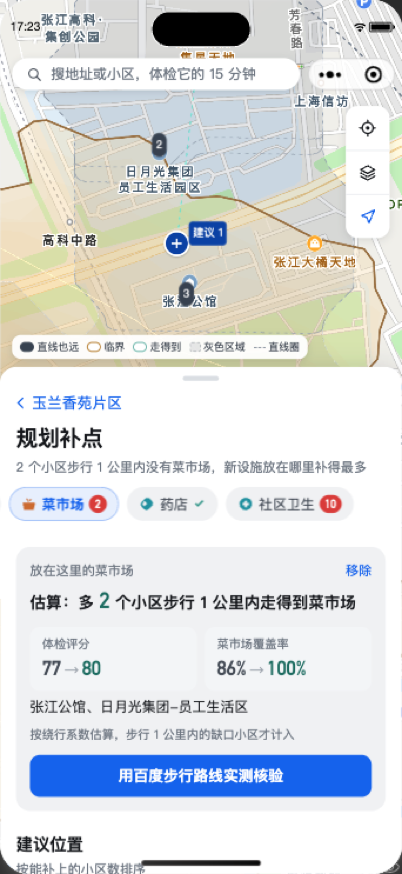

# 邻至 · 15 分钟生活圈智能体检与规划助手

> 15 分钟生活圈，不是画出来的，是走出来的。

邻至基于百度地图开放能力，用**真实步行路线**计算一个社区的 15 分钟步行等时圈，并逐个小区核对幼儿园、小学、菜市场、药店、社区卫生能否在步行 1 公里内走到。它找出"按直线画圈以为有、其实要绕路"的**绕路太远**（伪覆盖）和"直线就超出"的**直线也远**（盲区），给出一个看得懂的**体检评分**，在地图上标出设施匮乏的**灰色区域**，再给出**补点建议**并告诉你补上之后评分会变成多少。AI 体检顾问可以用自然语言回答问题，但回答里的每个数字都必须来自计算结果。

主应用是**微信小程序**（`apps/miniapp`），同一套服务端也提供 Web 工作台（`apps/web`）、REST/SSE API 和 MCP Server。

2026 上海开源软件应用创新大赛 · 开源 AI 工具赛道 · 百度地图命题参赛作品。

<p>



</p>

## 为什么需要它

规划里常用"以社区中心画一个半径 1 公里（或步行 15 分钟）的圆"来判断设施够不够。可人走的是路：河道、高架、封闭大院会让直线 760 米的社区卫生服务中心要走 1.4 公里（玉兰香苑片区樟盛苑）。我们在上海张江用百度地图实测了四个片区（2026-09 实测，小区名单逐条对照官方资料核实）：

| 片区                              | 小区 | 15 分钟真实可达 | 直线画圈 | 高估倍数  | 画圈找到的缺口 → 实测步行核实的缺口     | 体检评分（实测 / 直线） |
| --------------------------------- | ---- | --------------- | -------- | --------- | --------------------------------------- | ----------------------- |
| B 玉兰香苑片区（演示开场）        | 14   | 1.65 km²        | 3.48 km² | 2.12×     | 7 → **16**                              | **77** / 90             |
| A 申城佳苑片区（含小区轮廓）      | 12   | 1.86 km²        | 3.48 km² | 1.88×     | 0 → **3**                               | 94 / 100                |
| C 万科翡翠公园片区                | 7    | 2.10 km²        | 3.48 km² | 1.66×     | 14 → 14（1 公里内没有菜市场与社区卫生） | 60 / 60                 |
| V AI 小镇服务中心周边（决赛场地） | 7    | 1.15 km²        | 3.48 km² | **3.03×** | 7 → **12**                              | 66 / 80                 |

以玉兰香苑为例：张江社区卫生服务中心在片区西侧，按直线 1 公里算 71% 的小区够得着，按实测步行只有 29%；14 个小区里有 12 个步行 1 公里内缺至少一类设施，按直线距离只看得出 4 个。

**数据先核实，再下结论。** 百度"住宅区"检索会把居委会办公点、工业园大门、写字楼、已动迁的村宅和同一小区的楼栋也当成小区；把它们算进去，会凭空多出缺口、拉低每一类的覆盖率。邻至对照张江镇人民政府公布的住宅小区清单、浦东新区教育局《2026 年小学招生地段公示》（全区 6,993 行）和居村委地址逐条核实（[`data/official/community-review.json`](data/official/community-review.json)，每条写明理由、来源与日期），实时体检同样应用；小学按官方**对口学校**判定，而不是最近的学校；菜市场、小学、社区卫生与官方名录融合（确认、改类、补充百度漏收的设施）。

## 功能

| 能力           | 说明                                                                                                                                                                                                                       | 模块                              |
| -------------- | -------------------------------------------------------------------------------------------------------------------------------------------------------------------------------------------------------------------------- | --------------------------------- |
| 真实路网等时圈 | 不获取路网数据，只用百度批量算路和步行路线的实测耗时：三阶段主动采样 → 绕行系数去趋势插值 → 等值线；河道、高架等阻隔从耗时的矛盾中自动发现（Lipschitz 断裂检测）。小程序以每分钟一层的**热力图**呈现，可拖动时间轴"走一遍" | `packages/core`                   |
| 服务盲区判定   | 每个小区 × 幼儿园 / 小学 / 菜市场 / 药店 / 社区卫生，步行 1 公里：走得到、绕路太远（伪覆盖）、直线也远（盲区）、临界（±50 m）；未逐个算路的标为待核实，绝不当作缺口                                                        | `packages/core`                   |
| 对口小学       | 小学按官方招生地段匹配对口学校（弄号、小区名、期与块），算到对口校门的步行路线；校区未写明时如实标为待核实；商办产权小区标"无对口小学"                                                                                     | `packages/core` `packages/engine` |
| 体检评分       | 五类设施覆盖率（走得到的小区 ÷ 已核实小区）的平均 × 100，分档 良好 / 基本达标 / 需关注 / 待改善，并给出同样规则按直线距离算的分数作对照；雷达图看各类覆盖率                                                                | `apps/miniapp` `packages/agent`   |
| 灰色区域       | 按每个小区缺几类设施，在地图上标出设施匮乏的范围                                                                                                                                                                           | `packages/core`                   |
| 多源数据核实   | 百度地点检索 + 官方名录（浦东商务委标准化菜市场、浦东教育局小学与招生地段、市卫健委社区卫生）+ 人工核实小区清单；摊位并入菜市场，前置仓、饭店等按规则剔除                                                                  | `packages/engine` `data/official` |
| 规划补点       | 沿实测步行路线找候选点，贪心最大覆盖选址，排名前列的用百度实测核验；在地图上自己放一个设施，立即估算能补上哪些小区、评分从多少变成多少，再一键用百度实测核验，结果保存下来随时调出对比                                     | `packages/core` `apps/server`     |
| 圈内设施       | 15 分钟步行可达的设施，按医疗、教育、购物、养老、出行、生活服务、文体分组（含餐饮、超市、公交地铁等 18 类）                                                                                                                | `packages/core`                   |
| 百度 Web 服务  | 按接口配置鉴权（SN / IP 白名单）、QPS 调度与退避重试、SQLite 缓存、每日配额账本与预留、降级链、地理编码交叉校验、坐标转换（GCJ-02 / WGS84 → BD-09）                                                                        | `packages/baidu`                  |
| 实时体检       | 定位 → 设施检索与清洗 → 采样 → 等时圈 → 小区识别与核实 → 盲区与对口小学 → 灰色区域 → 选址 → 报告，逐阶段推送进度；同一中心点第二次体检完全命中缓存                                                                         | `packages/engine` `apps/server`   |
| 微信小程序     | 全屏地图 + 三段式面板：概览（评分、热力图、灰色区域、绕路最远的方向、方法）、缺口小区、周边设施；单个小区的步行路线证据；规划补点；体检报告；问 AI；搜索地址或坐标、选点体检                                               | `apps/miniapp`                    |
| AI 体检顾问    | 自然语言提问（"评分是怎么来的？""如果在这里开一家药店呢？"），工具调用 + 数字溯源校验：答案中的每个数字都必须出现在工具结果里并标注引用 [T1]；未配置大模型时用模板回答                                                     | `packages/agent`                  |
| MCP Server     | 同一套工具开放给 Claude、Cursor、Cherry Studio 等 MCP 客户端，支持 stdio 和 Streamable HTTP                                                                                                                                | `packages/mcp`                    |

## 快速开始

### 1. 服务端（Docker，推荐评审使用，无需任何 Key）

```bash
docker compose up --build
```

服务运行在 <http://localhost:8787>，浏览器打开即是 Web 工作台。未配置 Key 时以**样例模式**运行：四个片区（A、B、C、V）全部来自 2026-09 百度地图实测，不调用任何百度接口。

国内网络拉取镜像或依赖较慢时，可以换成镜像源（内容与官方相同）：

```bash
NODE_IMAGE=docker.m.daocloud.io/library/node:24-slim NPM_REGISTRY=https://registry.npmmirror.com/ docker compose up --build
```

### 2. 微信小程序

需要 Node.js ≥ 22.12、pnpm 10 和[微信开发者工具](https://developers.weixin.qq.com/miniprogram/dev/devtools/download.html)。

```bash
pnpm install
pnpm --filter @zoudedao/miniapp build      # 输出到 apps/miniapp/dist；开发时用 dev（监听编译）
```

1. 微信开发者工具 → 导入项目 → 选择**仓库根目录**（`project.config.json` 已指向 `apps/miniapp/dist`）。AppID 可用自己的小程序，或选"测试号"。
2. 右上角 详情 → 本地设置 → 勾选"**不校验合法域名、web-view（业务域名）、TLS 版本以及 HTTPS 证书**"（小程序默认连 `http://localhost:8787`，即上一步的服务端）。
3. 服务端在其他地址时，编译前设置 `ZDD_API_BASE`，例如 `ZDD_API_BASE=http://192.168.1.10:8787 pnpm --filter @zoudedao/miniapp build`。手机上正式访问需要 HTTPS 域名并加入小程序后台的"request 合法域名"。

### 3. 本地开发（不用 Docker）

```bash
pnpm install
cp .env.example .env.local   # 可选：填入自己的百度地图 Key
pnpm dev                     # API :8787，Web :5173
pnpm --filter @zoudedao/miniapp dev   # 另开一个终端：小程序监听编译
```

### 实时体检：配置自己的百度地图 Key

在[百度地图开放平台](https://lbsyun.baidu.com/)创建应用后，把 Key 写进 `.env.local`（已被 git 忽略，切勿提交）。下表中的值均为占位符：

| 变量                                         | 用途                                                                                                         | 示例                                      |
| -------------------------------------------- | ------------------------------------------------------------------------------------------------------------ | ----------------------------------------- |
| `BAIDU_SERVER_AK` / `BAIDU_SERVER_SK`        | 服务端 AK 与 SN 校验用的 SK：地理编码、逆地理编码、坐标转换、地点检索、步行路线                              | `Cd34…` / `Ef56…`                         |
| `BAIDU_SERVER_AUTH`                          | `sn`（默认）或 `ip`（IP 白名单模式，此时不填 SK）                                                            | `ip`                                      |
| `BAIDU_MATRIX_AK`                            | 批量算路专用 AK（IP 白名单模式）：实测批量算路在 SN 模式下始终返回 211                                       | `Gh78…`                                   |
| `BAIDU_TIER`                                 | 配额与并发档位：`personal`（个人认证，3 QPS）或 `enterprise`（30 QPS，实时体检可取更多小区）                 | `enterprise`                              |
| `BAIDU_DAILY_LIMITS`                         | 工单提额后的每日额度，`服务=额度` 逗号分隔，可加 `until=YYYY-MM-DD`                                          | `place=5000,reverse_geocoding=5000`       |
| `BAIDU_CACHE_PATH`                           | 接口缓存与配额账本（SQLite）                                                                                 | `data/cache/baidu.sqlite`                 |
| `VITE_BAIDU_BROWSER_AK`                      | 仅 Web 工作台：浏览器端 AK，只开通 JSAPI，务必在控制台设置 Referer 白名单                                    | `Ab12…`                                   |
| `LLM_BASE_URL` / `LLM_API_KEY` / `LLM_MODEL` | 可选：AI 顾问使用的 OpenAI 兼容接口（文心、DeepSeek、通义等，见 [packages/agent](packages/agent/README.md)） | `https://api.deepseek.com` / `sk-…` / `…` |

配置服务端 Key 后服务自动进入实时模式：在小程序搜索页输入地址、小区或百度坐标（如 `121.644, 31.190`），或点地图右侧的选点按钮在地图上点一个中心。

### MCP：在 AI 助手里体检

```bash
pnpm --filter "@zoudedao/mcp..." build
node packages/mcp/dist/cli.js            # stdio；加 --http 为 Streamable HTTP（127.0.0.1:8788/mcp）
```

Claude Desktop、Cursor、Cherry Studio 的配置示例见 [packages/mcp/README.md](packages/mcp/README.md)。

## 仓库结构

```
packages/core     纯算法：坐标转换、插值、等时圈、阻隔检测、采样规划、POI 清洗、对口小学、盲区、选址（浏览器、小程序与 Node 通用）
packages/baidu    百度地图 Web 服务客户端：鉴权、调度、缓存、配额账本、降级
packages/engine   实时体检流水线（把 core 和 baidu 串起来）
packages/agent    AI 体检顾问：工具注册表、数字溯源校验、OpenAI 兼容客户端、模板回答
packages/mcp      MCP Server（stdio / Streamable HTTP）
packages/eval     精度–配额评测：稠密实测参照网格、射线法与直线圆对照
apps/server       Fastify API：REST + SSE、样例、历史与分支、路线证据、托管 Web；scripts/ 为样例数据脚本
apps/miniapp      微信小程序（Taro 4 + React 18）
apps/web          Web 工作台（React + Vite + 百度地图 JSAPI GL）
data/official     官方名录：菜市场、小学、招生地段、社区卫生、排除清单、小区核实清单
data/samples      样例片区（A 含 OpenStreetMap 小区轮廓；B、C、V 为实时引擎输出）及步行路线证据
```

## 质量与工程

- 全部 TypeScript（strict、`noUncheckedIndexedAccess`），ESLint + Prettier。
- 1,034 项自动化测试（Vitest）：算法（含合成河道城市的误差测试）、百度客户端（签名向量、限流、配额、降级）、引擎（合成城市端到端）、对口小学与小区核实、API、Web 与小程序的模型层、AI 顾问与 MCP。测试从不调用真实的百度或大模型接口。
- CI：GitHub Actions（格式检查、Lint、构建含小程序、类型检查、测试、gitleaks 密钥扫描）；Gitee Go 流水线见 `.workflow/`。
- 密钥只存在于被 git 忽略的 `.env.local`；日志与错误信息中的 `ak`、`sk`、`sn`、`token` 一律打码；Docker 镜像不含任何 `.env` 文件。

## 文档

- [技术设计文档](docs/技术设计文档.md)：地图 API 调用策略、等时圈生成算法、多源 POI 清洗、服务盲区识别、对口小学与小区核实、评分、AI 设计、测试方案
- [真实对比测试报告](docs/真实对比测试报告.md)：等时圈精度 vs 配额（796 点稠密实测参照）、画圈 vs 实测步行的盲区对比、数据核实效果、接口性能与容错
- [API 约定](docs/api.md)
- 各模块 README：[core](packages/core/README.md) · [baidu](packages/baidu/README.md) · [engine](packages/engine/README.md) · [agent](packages/agent/README.md) · [mcp](packages/mcp/README.md) · [server](apps/server/README.md) · [web](apps/web/README.md)

## 数据与许可

- 代码以 [Apache-2.0](LICENSE) 授权。
- 样例 A 的小区轮廓与离线底图来自 OpenStreetMap（© OpenStreetMap 贡献者，ODbL）。
- 官方名录来自上海市及浦东新区政府公开信息，出处与日期写在每个文件里。
- 步行路线、设施与小区数据来自百度地图开放平台 Web 服务。使用本项目调用百度地图服务时，须遵守百度地图开放平台的服务条款。

详见 [NOTICE](NOTICE)。

## 参与贡献

见 [CONTRIBUTING.md](CONTRIBUTING.md)。安全问题请按 [SECURITY.md](SECURITY.md) 私下报告。
