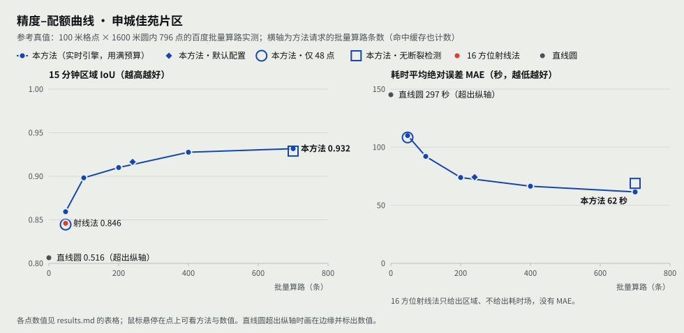
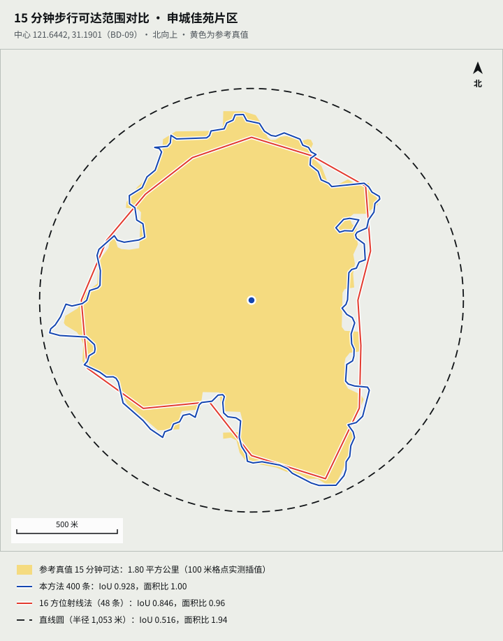

# 邻至 · 真实对比测试报告（上海张江）

> 测试时间：2026-09-26 至 2026-10-15。数据来源：百度地图开放平台 Web 服务（个人认证档开发，10 月起工单提额）、上海市与浦东新区政府公开信息、OpenStreetMap。本报告中的数字均可由仓库内的数据文件和脚本复现（见第 8 节），表格由 `research/report/build_test_report.py`、`research/report/review_effect.mts` 与 `packages/eval` 直接从数据生成。

## 0. 结论

1. **直线画圈严重高估步行可达范围。** 四个片区的直线 15 分钟圆（半径 1,053 m）是真实 15 分钟步行可达面积的 1.66–3.03 倍；决赛场地（海科路 1650 号）周边最严重，圆里 67% 的地方 15 分钟走不到。
2. **画圈会漏掉大量服务缺口。** 玉兰香苑片区 14 个小区 × 五类设施（幼儿园、小学、菜市场、药店、社区卫生）：直线 1 km 只能发现 7 个缺口，按百度实测步行路线核实的缺口有 16 个，涉及 12 个小区；体检评分按实测 77 分（基本达标），按直线算 90 分。社区卫生一项，直线以为 71% 的小区够得着，实际只有 29%。
3. **只用地图 API 测时，也能把等时圈做准。** 以 796 个稠密实测点为参考真值：默认配置（240 条批量算路）的 15 分钟区域 IoU 为 0.916、逐点判断准确率 95.5%；同题常见的 16 方位射线法（48 条）为 0.846 / 90.4%，直线圆为 0.516 / 52.0%。与百度官方 1 km 等距圈逐小区对照，判定一致率 95.2%（第 2 节末）。
4. **数据必须先核实。** 百度"住宅区"检索混入了居委会、工业园大门、写字楼、已动迁村宅、同一小区的楼栋和位置标错的点：玉兰香苑片区 28 个检索结果里只有 14 个是独立的住宅小区，不核实会多报 24 个缺口、评分低 7 分。设施侧，百度把两家官方标准化菜市场标成"购物""生鲜超市"，把店名带"（孙桥菜场店）"的饭店当成菜场摊位。对照官方名录与人工核实清单后，四个片区的判定全部有据可查。
5. **小学看对口学校，不看最近学校。** 按浦东新区 2026 年招生地段，玉兰香苑片区 13 个小区全部匹配到对口学校并实测步行路线；商办产权的张江公馆没有对口小学，如实标出。只写到学校、未写校区的（孙桥小学）不推定校区，标为待核实。
6. **配额可控。** 企业档冷启动一次体检用地点检索约 11 次、批量算路约 220–420 条，同一中心再测全部命中缓存；个人档单次也在预算内完成。

## 1. 测试对象与环境

| 编号 | 片区                                  | 中心（BD-09）         | 作用                                                                            |
| ---- | ------------------------------------- | --------------------- | ------------------------------------------------------------------------------- |
| B    | 玉兰香苑片区                          | 121.638346, 31.205134 | 演示开场：大型动迁社区，所有判定已核实                                          |
| A    | 申城佳苑片区（孙环路 × 高木桥路）     | 121.644195, 31.190070 | 精度评测样例：被华夏高架、S20 外环、河道阻隔；含 12 个小区的 OpenStreetMap 轮廓 |
| C    | 万科翡翠公园片区                      | 121.618088, 31.185923 | 离决赛场地 0.95 km                                                              |
| V    | AI 小镇服务中心周边（海科路 1650 号） | 121.624269, 31.193070 | 决赛路演场地                                                                    |

- 百度地图开放平台：个人认证档开发（地点检索 100 次/日、批量算路 5,000 条/日、3 QPS），2026-10 起工单提额（地点检索 5,000 次/日、批量算路 100,000 条/日、30 QPS）。
- 步行耗时：百度批量算路的耗时恒等于"距离 ÷ 1.17 米/秒"（实测）。老年人画像按 0.9 米/秒换算。
- 判定口径：五类设施（幼儿园、小学、菜市场、药店、社区卫生）步行 1 km；小学按官方对口学校。
- 小区（需求点）：A 为 OpenStreetMap 小区轮廓的几何中心；B、C、V 为百度"住宅区 / 小区"检索得到的出入口（优先导航点），限于中心 1,100 m 内，并按小区核实清单处理（§3.3）。

## 2. 等时圈精度：稠密参照网格评测（A 片区）

**参考真值。** 以 A 的中心为起点，对 100 m 格点、1,600 m 圆内的 796 个点逐一用百度批量算路实测步行距离（2026-09-28，全部成功），作为"标准答案"。15 分钟参考区域面积 1.798 km²。

**比较的方法。**

- 直线圆：不调用接口。
- 16 方位射线法：同题作品的常见做法，16 个方位 × 3 个半径共 48 条路线，每个方位按射线插值出 15 分钟可达点，再连成多边形。
- 本方法：实时引擎的等时圈部分（粗采样 48 条 + 4 条步行路线 + 边界加密），分别给 48 / 100 / 200 / 400 / 700 条批量算路预算；"默认"为产品实际配置（收敛即停）；另做关闭阻隔检测的消融实验。
- "本方法·仅 48 点"与射线法用完全相同的 48 条路线，只换估计算法。

#### 15 分钟区域与参考区域比较

区域在 20 米网格（±1600 米）的节点上比较；参考区域是参考场中耗时 < 900 秒的节点，面积 1.798 平方公里。

| 方法                     | 批量算路（条） | 步行路线（次） | 面积（km²） | 面积比 | IoU   | 对称差（km²） | 多算（km²） | 漏算（km²） |
| ------------------------ | -------------- | -------------- | ----------- | ------ | ----- | ------------- | ----------- | ----------- |
| 直线圆                   | 0              | 0              | 3.487       | 1.94   | 0.516 | 1.689         | 1.689       | 0.000       |
| 16 方位射线法            | 48             | 0              | 1.727       | 0.96   | 0.846 | 0.294         | 0.112       | 0.182       |
| 本方法·仅 48 点          | 48             | 0              | 1.780       | 0.99   | 0.845 | 0.302         | 0.142       | 0.160       |
| 本方法 48 条             | 48             | 4              | 1.972       | 1.10   | 0.859 | 0.285         | 0.230       | 0.056       |
| 本方法 100 条            | 100            | 4              | 1.812       | 1.01   | 0.898 | 0.194         | 0.104       | 0.090       |
| 本方法 200 条            | 200            | 4              | 1.829       | 1.02   | 0.910 | 0.171         | 0.101       | 0.070       |
| 本方法 400 条            | 400            | 4              | 1.801       | 1.00   | 0.928 | 0.135         | 0.069       | 0.066       |
| 本方法 700 条            | 700            | 4              | 1.812       | 1.01   | 0.932 | 0.128         | 0.071       | 0.057       |
| 本方法·默认              | 240            | 4              | 1.810       | 1.01   | 0.916 | 0.157         | 0.085       | 0.072       |
| 本方法 700 条·无断裂检测 | 700            | 4              | 1.784       | 0.99   | 0.929 | 0.132         | 0.059       | 0.073       |

#### 参考点逐点检验

直接用实测的参考点检验，不经过参考场的插值：只取直线距离 ≤ 1,053 米（超出这个距离 15 分钟一定走不到）且有实测结果的参考点，去掉方法自己测过的点（5 米以内）。共 348 点，其中 15 分钟可达 181 点。

| 方法                     | 检验点数       | 分类准确率 | 边界带准确率（±180 秒） | 误判为可达 | 误判为不可达 | MAE（秒） | P90（秒） | 平均偏差（秒） |
| ------------------------ | -------------- | ---------- | ----------------------- | ---------- | ------------ | --------- | --------- | -------------- |
| 直线圆                   | 348            | 52.0%      | 53.1%（143 点）         | 48.0%      | 0.0%         | 297.1     | 665.8     | -297.1         |
| 16 方位射线法            | 344（去掉 4）  | 90.4%      | 79.9%（139 点）         | 8.1%       | 10.7%        | —         | —         | —              |
| 本方法·仅 48 点          | 344（去掉 4）  | 89.5%      | 77.7%（139 点）         | 8.8%       | 11.9%        | 108.4     | 249.7     | -20.9          |
| 本方法 48 条             | 342（去掉 6）  | 91.8%      | 84.2%（139 点）         | 11.1%      | 4.0%         | 110.0     | 279.9     | -65.3          |
| 本方法 100 条            | 342（去掉 6）  | 93.9%      | 87.1%（139 点）         | 5.8%       | 6.3%         | 92.1      | 248.7     | -32.0          |
| 本方法 200 条            | 338（去掉 10） | 95.3%      | 91.2%（136 点）         | 4.1%       | 5.2%         | 73.9      | 205.9     | -26.4          |
| 本方法 400 条            | 330（去掉 18） | 96.4%      | 92.4%（131 点）         | 3.6%       | 3.6%         | 66.4      | 184.4     | -25.1          |
| 本方法 700 条            | 312（去掉 36） | 97.1%      | 93.0%（115 点）         | 1.9%       | 3.7%         | 61.5      | 173.0     | -28.4          |
| 本方法·默认              | 337（去掉 11） | 95.5%      | 90.4%（136 点）         | 3.5%       | 5.2%         | 74.2      | 208.8     | -23.5          |
| 本方法 700 条·无断裂检测 | 313（去掉 35） | 96.5%      | 91.5%（118 点）         | 1.9%       | 4.9%         | 68.9      | 192.8     | -33.0          |





**解读。**

- 同样 48 个点，本方法的插值与射线法打平（IoU 0.845 对 0.846）。本方法的优势来自主动采样：沿绕行最明显的方向取步行路线，再围绕 15 分钟边界和已发现的阻隔加密。默认配置 240 条时，逐点判错率从射线法的约 9.6% 降到 4.5%，耗时平均误差 74 秒。
- 射线法的多边形在河道、高架处"抄近路"（叠加图红线），同时在凹进去的方向漏掉可达区域；本方法的边界贴着参考区域走，能表现出阻隔造成的缺口。
- 阻隔检测（Lipschitz 断裂）在 700 条时把 IoU 从 0.929 提到 0.932、MAE 从 69 秒降到 62 秒，作用有限但为正；它的主要价值在于把加密点引向阻隔附近，并在地图上标出阻隔。
- 局限：参考真值是百度的步行路线模型，不是实地步行；实测表明百度轻量步行路线的分段耗时比批量算路慢 3.5%–6.6%（含过街等待），因此真实步行时间可能更长，本报告的结论偏保守。

#### 与百度官方等时圈、等距圈对照

百度的等时圈、等距圈（`/logistics_truck/v1/isochrone`、`/isodistance`）需工单开通，2026-09-30 起可用。它每次只返回一个中心、一个时长或距离的单个多边形，不含设施与小区判定，所以作为独立对照，而不进入核心链路（2026-10-02 实测，按当时的样例）：

| 对照                                               | 结果                                                                                                                               |
| -------------------------------------------------- | ---------------------------------------------------------------------------------------------------------------------------------- |
| 从设施出入口的 1 km 步行等距圈 vs 本项目逐小区判定 | 四个片区 310 项中 295 项一致（95.2%；A 98.3%、B 90.0%、C 100%、V 100%）；不一致的 15 项都在多边形边缘 10–186 m 内                  |
| 以小区为中心的 1 km 等距圈 vs 本项目判定           | 310 项中 291 项一致（93.9%），不一致项距边缘 ≤ 120 m                                                                               |
| 15 分钟等时圈 vs 稠密参照                          | 官方按约 1.40 m/s 步行，900 秒时面积偏大 1.45 倍（A）/ 1.63 倍（V）；按速度折算到 752 秒后 IoU 0.871 / 0.746，本项目 0.916 / 0.861 |

结论：官方接口与本项目的判定高度一致，差异集中在 1 km 边缘；本项目在只用基础接口（批量算路、步行路线）的前提下，等时圈精度不低于官方高级服务，并额外给出耗时场、逐小区判定与设施统计。原始结果见 `research/api-probe/08_official_isochrone.md`、`09_official_isodistance.md`。

## 3. 服务盲区识别：画圈 vs 走一遍

判定：步行 ≤ 1 km 为**走得到**（覆盖）；直线 ≤ 1 km 但步行 > 1 km 为**绕路太远**（伪覆盖）；直线就超过 1 km 为**直线也远**（盲区）；步行距离在 1 km ± 50 m 内另标**临界**。没有对该小区单独算路的、对口校区未写明的标为**待核实**，不计入缺口；商办产权小区的小学标为**无对口**，也不计入。

### 3.1 B 玉兰香苑片区 14 个小区逐项判定（直线 / 步行）

| 小区                  | 幼儿园               | 小学                       | 菜市场                     | 药店                 | 社区卫生                   |
| --------------------- | -------------------- | -------------------------- | -------------------------- | -------------------- | -------------------------- |
| 兰沁苑                | 278 / 312 m · 走得到 | 136 / 148 m · 走得到       | 378 / 497 m · 走得到       | 390 / 562 m · 走得到 | 1,047 / 1,018 m · 直线也远 |
| 张江公馆              | 460 / 736 m · 走得到 | 无对口（商办）             | 1,074 / 1,081 m · 直线也远 | 161 / 246 m · 走得到 | 1,264 / 1,182 m · 直线也远 |
| 日月光集团-员工生活区 | 663 / 1,015 m · 临界 | 1,336 / 1,362 m · 直线也远 | 1,216 / 1,224 m · 直线也远 | 246 / 245 m · 走得到 | 1,307 / 1,312 m · 直线也远 |
| 春港丽园              | 553 / 918 m · 走得到 | 596 / 958 m · 临界         | 504 / 922 m · 走得到       | 357 / 633 m · 走得到 | 1,182 / 1,645 m · 绕路太远 |
| 樟盛苑                | 198 / 244 m · 走得到 | 776 / 999 m · 临界         | 613 / 953 m · 临界         | 54 / 70 m · 走得到   | 759 / 1,390 m · 绕路太远   |
| 流明新苑              | 316 / 468 m · 走得到 | 427 / 625 m · 走得到       | 250 / 378 m · 走得到       | 109 / 73 m · 走得到  | 935 / 1,332 m · 绕路太远   |
| 玉兰香苑一期          | 184 / 331 m · 走得到 | 282 / 394 m · 走得到       | 558 / 733 m · 走得到       | 218 / 216 m · 走得到 | 747 / 1,348 m · 绕路太远   |
| 玉兰香苑一期B块       | 39 / 84 m · 走得到   | 125 / 148 m · 走得到       | 613 / 677 m · 走得到       | 107 / 120 m · 走得到 | 806 / 1,114 m · 绕路太远   |
| 玉兰香苑三期          | 335 / 435 m · 走得到 | 359 / 499 m · 走得到       | 492 / 709 m · 走得到       | 341 / 366 m · 走得到 | 665 / 1,146 m · 绕路太远   |
| 玉兰香苑二期A块       | 229 / 343 m · 走得到 | 813 / 1,028 m · 临界       | 170 / 311 m · 走得到       | 187 / 302 m · 走得到 | 188 / 466 m · 走得到       |
| 玉兰香苑二期B块       | 264 / 359 m · 走得到 | 849 / 1,044 m · 临界       | 198 / 327 m · 走得到       | 216 / 318 m · 走得到 | 179 / 482 m · 走得到       |
| 玉兰香苑二期C块       | 144 / 106 m · 走得到 | 772 / 791 m · 走得到       | 60 / 74 m · 走得到         | 59 / 65 m · 走得到   | 168 / 457 m · 走得到       |
| 玉兰香苑四期          | 292 / 294 m · 走得到 | 199 / 204 m · 走得到       | 932 / 977 m · 临界         | 407 / 420 m · 走得到 | 1,124 / 1,045 m · 直线也远 |
| 益丰新村              | 190 / 256 m · 走得到 | 443 / 466 m · 走得到       | 289 / 351 m · 走得到       | 150 / 213 m · 走得到 | 482 / 788 m · 走得到       |

合计：直线 1 km 规则找到 7 个缺口；按实测步行距离核实 16 个（绕路太远 9、直线也远 7），涉及 12 个小区；待核实 0 项。画圆法漏掉 9 个，占已核实缺口的 56.2%。

合计：直线 1 km 规则找到 7 个缺口；按实测步行距离核实 16 个（绕路太远 9、直线也远 7），涉及 12 个小区，没有待核实。画圆法漏掉 9 个，占已核实缺口的 56.2%。

说明：直线距离按设施 POI 坐标计，步行路线终点是设施出入口（导航点），所以个别项（如兰沁苑到社区卫生）的步行距离会略小于直线距离。

### 3.2 四个片区汇总

| 片区                         | 小区数 | 15 分钟可达 | 直线圆    | 高估倍数 | 画圈缺口 | 步行核实缺口（其中绕路太远） | 缺设施的小区 | 待核实 | 体检评分（实测 / 直线） | 采样点 | LOO MAE / P90（秒） |
| ---------------------------- | ------ | ----------- | --------- | -------- | -------- | ---------------------------- | ------------ | ------ | ----------------------- | ------ | ------------------- |
| B 玉兰香苑片区（演示开场）   | 14     | 1.645 km²   | 3.483 km² | 2.12×    | 7        | 16（9）                      | 12           | 0      | 77 / 90                 | 386    | 59.7 / 119.8        |
| A 申城佳苑片区（含小区轮廓） | 12     | 1.857 km²   | 3.483 km² | 1.88×    | 0        | 3（3）                       | 3            | 12     | 94 / 100                | 693    | 54.4 / 125.3        |
| C 万科翡翠公园片区           | 7      | 2.096 km²   | 3.483 km² | 1.66×    | 14       | 14（0）                      | 7            | 0      | 60 / 60                 | 381    | 60.2 / 108.6        |
| V AI 小镇服务中心周边        | 7      | 1.151 km²   | 3.483 km² | 3.03×    | 7        | 12（5）                      | 7            | 4      | 66 / 80                 | 434    | 77.6 / 199.5        |

体检评分 = 五类设施覆盖率（走得到的已核实小区 ÷ 已核实小区）的平均 × 100；"直线"一栏用同样的设施和规则，只把步行距离换成直线距离。

典型案例：

- 樟盛苑 → 社区卫生：张江社区卫生服务中心直线 759 m，步行 1,390 m（绕路 1.83 倍）。
- 川杨新苑四期 → 菜市场：浦商生鲜(申城佳苑店) 直线 734 m，步行 1,281 m；不融合官方名录时（百度把它标为"购物"）直线 1,084 m，会被判为直线也远。
- 万科翡翠公园片区 7 个小区 1 km 内既没有菜市场，也没有社区卫生服务站——缺的是设施本身，不是绕路，评分 60 分里直线与实测相同。
- 日月光员工生活区：对口的张江镇中心小学直线 1,336 m、步行 1,362 m。

### 3.3 小区核实

百度"住宅区"检索结果逐条对照张江镇人民政府公布的住宅小区清单（104 个小区）、浦东新区教育局《2026 年小学招生地段公示》（全区 6,993 行）与张江镇居村委地址一览表，结论写在 `data/official/community-review.json`（每条含百度 uid、理由、来源与核实日期）：

| 类型                 | 条数 | 例子                                                           |
| -------------------- | ---- | -------------------------------------------------------------- |
| 居委会办公点         | 7    | 江夏社区、江丰社区、华顺社区                                   |
| 不是住宅             | 4    | 益丰工业小区（工业园大门）、梦想园（写字楼）、科荣园（办公楼） |
| 同一小区的楼栋       | 3    | 益丰路55弄109号（春港丽园）、张江荣科苑（= 万科翡翠公园一期）  |
| 已动迁               | 1    | 华夏中路顾家宅                                                 |
| 位置标错             | 1    | 华陇小区（官方在建中路461弄，百度点位在 4 km 外）              |
| 查无此小区           | 6    | 东窑新村、创新公寓、川杨兰苑                                   |
| 商办产权，无对口小学 | 2    | 张江公馆、绿地MTOWN                                            |
| 地址写法不同         | 1    | 日月光员工生活区（银冬路 / 银东路568号）                       |
| 官方名称             | 16   | 益江路511弄 → 玉兰香苑二期A块                                  |

**效果（同一批路线，用应用自己的判定代码计算）：**

| 片区                  | 小区    | 画圈缺口 | 步行核实缺口 | 待核实  | 体检评分（实测 / 直线） |
| --------------------- | ------- | -------- | ------------ | ------- | ----------------------- |
| B 玉兰香苑片区        | 28 → 14 | 12 → 7   | 40 → 16      | 15 → 0  | 70 / 91 → 77 / 90       |
| A 申城佳苑片区        | 12 → 12 | 0 → 0    | 3 → 3        | 12 → 12 | 94 / 100 → 94 / 100     |
| C 万科翡翠公园片区    | 12 → 7  | 24 → 14  | 24 → 14      | 5 → 0   | 60 / 60 → 60 / 60       |
| V AI 小镇服务中心周边 | 10 → 7  | 10 → 7   | 18 → 12      | 7 → 4   | 64 / 80 → 66 / 80       |

申城佳苑没有变化：它的小区来自 OpenStreetMap 轮廓，本来就都是住宅小区；它的 12 项待核实是孙桥小学的校区问题（§7）。

**实时体检同样生效。** 在玉兰香苑中心以企业档重新体检一次：引擎自动剔除 6 个居委会和 8 个核实清单中的点，保留的 14 个小区与人工核实结果一致；13 个小区按对口地段匹配并实测到对口校门，1 个商办小区标为无对口，没有待核实。

## 4. 多源 POI 清洗

**问题。** 百度地点检索按"菜市场$菜场$农贸市场$生鲜市场"检索并按分类过滤时：

- 浦商生鲜(申城佳苑店)（孙建路 858 号，距 A 中心 309 m）只标为"购物"，检索不返回；
- 浦商生鲜(环西店)、浦商农产品(紫薇店) 标为"生鲜超市"，赛题严格口径不计；
- 菜场内的摊位（优品生鲜、英英肉店、雨润生鲜精选）会被当成独立的菜市场；
- 店名带"（孙桥菜场店）"的饭店（仙味楼上海本帮菜江浙菜、味知香）会被当成菜场摊位。

**做法。** 浦东新区商务委《2023 年四季度浦东新区菜市场实效测评得分及排名》列出全区 196 家标准化菜市场（171 家参评），已转录为 `data/official/pudong-markets-2023q4.json` 并用百度地理编码补坐标（170 条门址级精确）。体检时：摊位按 parent_id 与店名并入所属菜市场；标签为"美食"的店先归为餐饮，不算摊位；名录内的门店与百度 POI 按分店名或门牌匹配（250 m 内），匹配上则改正类别，匹配不上则按官方地址补入；装修改造、业态调整的门店不计。小学融合浦东教育局 2026 年招生名单（267 个校区），社区卫生融合市卫健委社区卫生服务中心名单；线上买菜的前置仓按排除清单剔除。

**效果（同一批小区、同一批路线，2026-09-28 实时引擎）。**

| 片区       | 名录内门店（检索半径内） | 百度一致 | 改类 | 补入 | 菜市场缺口：融合前 → 后 |
| ---------- | ------------------------ | -------- | ---- | ---- | ----------------------- |
| A 申城佳苑 | 4                        | 2        | 1    | 1    | 11 → 5                  |
| B 玉兰香苑 | 4                        | 2        | 1    | 1    | 13 → 10                 |

按官方名录计，A 周边 4 家正常营业的标准化菜市场中，百度按严格口径只识别出 2 家（召回 50%）；融合后 4 家全部计入。名录发布于 2023 年；玉兰香苑片区依赖的浦商邻里荟益江店在 2025 年三季度的官方测评中仍在营业并评为优秀。

## 5. 接口调用、性能与容错

| 项目                 | 实测                                                                                                                                                                                                                                                        |
| -------------------- | ----------------------------------------------------------------------------------------------------------------------------------------------------------------------------------------------------------------------------------------------------------- |
| 单次冷启动体检的配额 | 个人档：逆地理编码 1 次、地点检索 5–20 页（含民生与生活服务类）、批量算路约 380–430 条、轻量步行路线 4 次；企业档玉兰香苑一次：地点检索 11 次、批量算路约 224 条（部分命中缓存）                                                                            |
| 单次冷启动用时       | 28–40 秒（个人档，3 QPS）；逐阶段通过 SSE 推送进度与中间结果                                                                                                                                                                                                |
| 同一中心再测         | 全部命中 SQLite 缓存，0 次调用、结果一致                                                                                                                                                                                                                    |
| 样例数据维护         | 小区核实与对口小学重算：批量算路 1 条；规划建议按核实后的小区重新选址并实测核验：批量算路 36 条；路线证据补取：步行路线 1 次                                                                                                                                |
| 并发限流             | 遇到百度"并发量超限"时按同一批次指数退避重试（1.1 s → 19 s），全部成功，未拆小批次、未丢数据                                                                                                                                                                |
| 配额保护             | 配额账本在请求前预留，超过当日 90% 或本次上限即拒绝；配额耗尽、密钥错误、超时分别以 quota_exhausted / auth / timeout 事件结束，并给出中文说明                                                                                                               |
| 降级                 | 批量算路的失败格在下一轮自动重试；仍没有实测路线的判定按绕行系数估计、标为"待核实"，不计入缺口。步行路线、小区检索、逆地理编码失败时跳过该步骤并在结果中注明，等时圈照常输出。百度客户端另提供"批量算路 → 轻量步行路线 → 估计"的逐级降级（`walkDistances`） |

## 6. AI 体检顾问

- 数字溯源校验：回答中的每个数字都必须出现在本轮工具结果中，并带 [T#] 引用；精度不得降低（1.88× 不能写成 1.9×）。校验用例（含易混的近似数、单位换算、名称中的数字）全部通过。
- 实测（DeepSeek，2026-10-13）："这个片区体检评分多少？为什么？"——回答给出 70 分、需关注、按直线距离 91 分与各类覆盖率，28 个数字全部通过校验；"社区卫生为什么得分这么低？"——25 个数字全部通过。（当时为核实前的玉兰香苑数据。）
- 大模型写错数字时先要求改写一次，仍不通过则改用模板回答并说明原因；未配置大模型时，模板回答覆盖"老人买菜方便吗""如果在某处开一家药店""对比两个片区""导出体检报告"等问题。

## 7. 局限与后续

1. **孙桥小学校区未明**：2026 年招生公示中孙桥小学有张江、申江两个校区，招生地段只写到学校。两个校区到同一小区可相差 1 km 以上（川杨新苑三期：310 m 对 1,386 m），推定校区会直接改变结论，所以申城佳苑 12 项、AI 小镇周边 4 项标为待核实，待向学校确认。
2. **社区卫生服务站名单未公开**：官方名录只到社区卫生服务中心；玉兰香苑片区 1.8 km 内百度只有张江社区卫生服务中心与川杨新苑服务站两处，未发现遗漏，但仍可能有官方未公布、百度也未收录的站点。
3. 参考真值来自百度步行路线模型，尚未实地步行计时；百度批量算路的耗时不含过街等待，本报告的结论偏保守。
4. A 样例的小区位置是 OpenStreetMap 轮廓的几何中心，不是出入口；实时引擎使用出入口。
5. 菜市场名录为 2023 年四季度版本；药店尚未对照官方零售药店名单。
6. 小区核实目前覆盖张江的四个样例片区；其他地区的实时体检会自动剔除居委会（名称规则），其余非住宅点需按同样流程逐步补充核实清单。

## 8. 复现

```bash
pnpm install
pnpm -r test                                            # 1,034 项自动化测试，不调用任何真实接口
pnpm --filter @zoudedao/eval eval plan A                # 评测配额计划（不调用接口）
pnpm --filter @zoudedao/eval eval:live run A            # 实测参考网格与各方法（需要自己的百度 Key）
pnpm --filter @zoudedao/eval eval score A               # 只用已有数据重新评分
python3 research/zhangjiang/official_markets_patch.py   # 按官方名录校正精修样例（幂等）
python3 research/report/build_test_report.py            # 重新生成本报告 §3.1、§3.2 的表格
(cd packages/agent && npx tsx --conditions=source ../../research/report/review_effect.mts)   # §3.3 小区核实前后
```

原始数据：`research/eval/A/`（参考网格与各方法结果）、`research/live-runs/`（实时体检结果）、`research/zhangjiang/raw/`（百度接口实测记录，Key 已打码）、`data/official/`（官方名录与核实清单）、`research/api-probe/08_official_isochrone.md`、`09_official_isodistance.md`（官方等时圈 / 等距圈对照）。

样例数据脚本（`apps/server/scripts/`）：`review-communities.ts`（应用小区核实清单、重算对口小学与规划建议）、`fix-market-stalls.ts`（纠正被当成菜场摊位的饭店）、`prefetch-routes.ts`（预取步行路线证据）。
